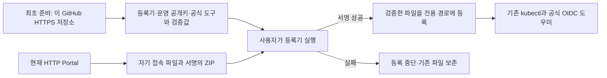

# Portal kubectl access

Portal Kubernetes 접속 파일의 서명을 검증하고 사용자 전용 경로에 등록하는 도구입니다.

**현재 상태: 등록기 코드 검증 완료, 운영 공개키 등록 전 준비 단계입니다.** 이 저장소에는 사용자별 kubeconfig, 로그인 token, refresh token, 서명 개인키를 게시하지 않습니다. 현재 `portal-kubeconfig.pub`는 배포하지 않았으며 운영 서명키를 준비한 뒤 공개키를 등록해야 실제 Portal 다운로드 파일을 검증할 수 있습니다. 시험 키를 운영 키로 제공하지 않습니다.

## 지원 대상과 검증

| 대상 | 확인한 범위 |
|---|---|
| Windows x86_64 | Windows PowerShell5.1·PowerShell7.6.5, 실제 minisign0.12를 사용한 등록 검사 각각22건 |
| Ubuntu24.04 x86_64 | Python3.12.3·minisign0.12, 등록25건과 Linux 메모리 시험 키의 실제 서명/검증/등록5건 |
| WSL Ubuntu | Ubuntu 공통 코드를 사용. Windows binary 호출·브라우저 복귀·저장소·VPN/DNS 연동은 추가 검증 대상 |

위 결과는 합성 파일과 격리 검사입니다. 실제 사용자 로그인·클러스터 API/RBAC·Portal 다운로드 경로의 종단 검증 완료를 뜻하지 않습니다.

## 사용 흐름

최초 설치 자료는 사용자가 미리 확인한 이 저장소의 정확한 HTTPS 주소에서 준비합니다. HTTP Portal에서 받은 키·등록기·검증값만으로 최초 신뢰를 만들지 않습니다. 준비 후 일반 kubectl 명령마다 GitHub에 접속하지 않습니다.

- [Windows 등록기](clients/windows/Register-PortalKubeconfig.ps1)
- [Ubuntu/WSL Ubuntu 등록기](clients/ubuntu/register_portal_kubeconfig.py)
- [최초 준비와 등록 방법](docs/setup.md)
- [고정 minisign 출처와 관측 해시](toolchain.json)
- [제공 준비 상태](release-status.json)

등록기는 로그인이나 keyring 초기화를 실행하지 않습니다. 기본 kubeconfig에 자동 병합하지 않으며 정확한 검증 파일만 새 경로에 등록합니다. 사용자별 ZIP은 이 공개 저장소에 올리지 않습니다.

## 후속 Portal HTTPS 전환

현재는 **새 GitHub 저장소를 최초 신뢰 배포처**로 사용합니다. 추후 Portal 웹·API·다운로드의 HTTPS 전환과 인증서 신뢰·갱신·로그인/쿠키·다운로드 검증을 마치면 **최초 준비 자료도 Portal에서 직접 제공**합니다. 그때 사용자 안내/다운로드 경로를 전환하고 기존 GitHub 이용자의 안내를 갱신합니다. 파일 서명과 등록 절차의 유지·간소화는 해당 전환 범위에서 검토하며 자동 폐기하지 않습니다.
